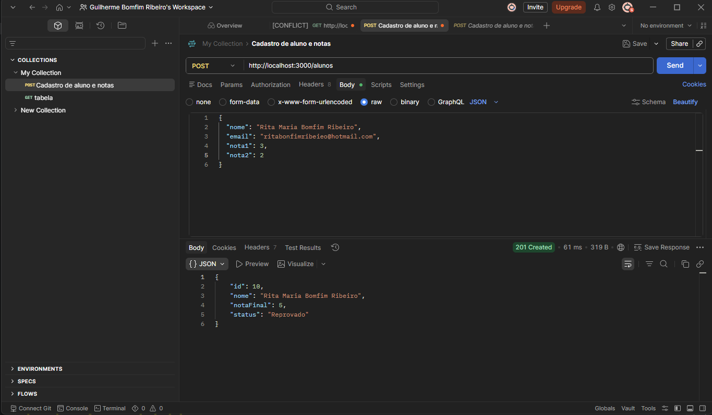
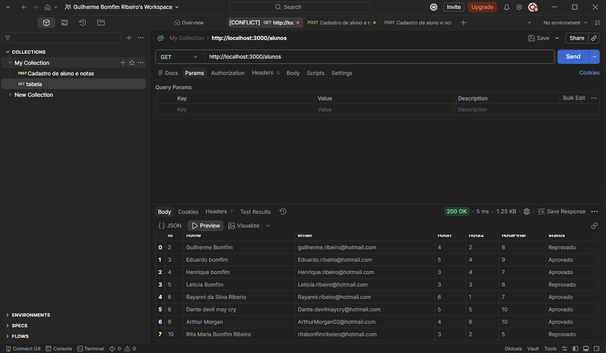

# API de Gerenciamento de Alunos

API REST desenvolvida em Node.js com Express e MySQL para cadastro e consulta de alunos, com validação dos dados e cálculo automático do resultado.

## Sobre o Projeto

Projeto desenvolvido como atividade acadêmica da graduação em Análise e Desenvolvimento de Sistemas.

A API recebe os dados de um aluno e suas duas notas, valida as informações, calcula a nota final, define o status (Aprovado/Reprovado) e salva tudo em um banco MySQL.

## Tecnologias

- Node.js
- Express
- MySQL (mysql2)
- Postman (testes manuais dos endpoints)

## Endpoints

| Método | Rota           | O que faz                                      | Respostas        |
| ------ | -------------- | ---------------------------------------------- | ---------------- |
| GET    | `/alunos`      | Lista todos os alunos                          | 200, 500         |
| GET    | `/alunos/:id`  | Busca um aluno pelo ID                         | 200, 404, 500    |
| POST   | `/alunos`      | Cadastra um aluno e calcula nota final/status  | 201, 400, 500    |

### Exemplo de cadastro

```json
POST /alunos
{
  "nome": "Maria Silva",
  "email": "maria@exemplo.com",
  "nota1": 6,
  "nota2": 5
}
```

Resposta (201):

```json
{
  "id": 1,
  "nome": "Maria Silva",
  "notaFinal": 11,
  "status": "Aprovado"
}
```

## Regras de negócio

- Nome, e-mail, `nota1` e `nota2` são obrigatórios.
- As notas devem ser números entre 0 e 10.
- A nota final é a soma das duas notas.
- Status **Aprovado** quando a nota final é 7 ou mais; caso contrário, **Reprovado**.

## Estrutura da tabela

```sql
CREATE TABLE alunos (
  id INT AUTO_INCREMENT PRIMARY KEY,
  nome VARCHAR(100),
  email VARCHAR(100),
  nota1 INT,
  nota2 INT,
  notaFinal INT,
  status VARCHAR(20)
);
```

## Como executar

1. Crie o banco `escola` no MySQL e a tabela acima.
2. Instale as dependências: `npm install`
3. Copie `.env.example` para `.env` e preencha com os dados do seu MySQL.
4. Inicie o servidor: `npm run dev` (ou `node index.js`). A API sobe em `http://localhost:3000`.

## Testes no Postman

### POST /alunos



### GET /alunos



## Próximos passos

- Atualização (`PUT`) e exclusão (`DELETE`) de alunos.
- Cálculo da nota final por média.

## Autor

**Guilherme Bomfim Ribeiro**

- GitHub: https://github.com/GuiH666
- LinkedIn: https://www.linkedin.com/in/guilherme-bomfim-ribeiro-2623aa218/
