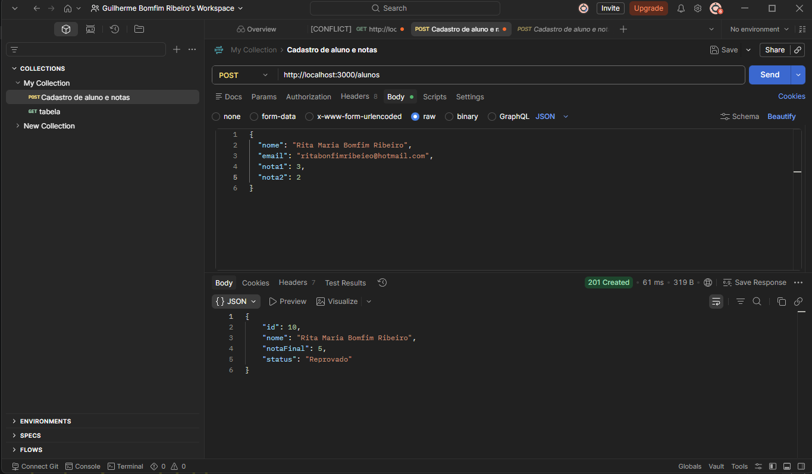
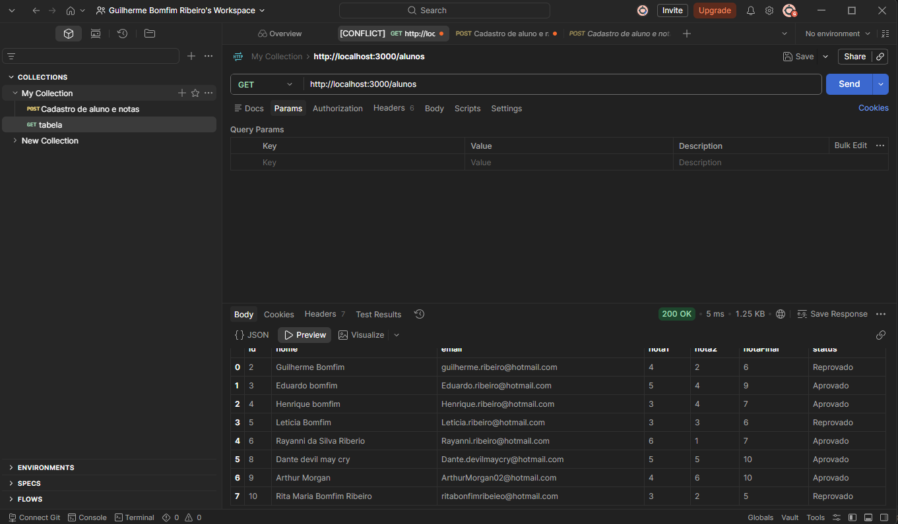

# API de Gerenciamento de Alunos

[](https://github.com/GuiH666/API-de-Gerenciamento-de-Alunos/actions/workflows/ci.yml) 

API REST desenvolvida em Node.js com Express e MySQL para cadastro e consulta de alunos, com validação dos dados e cálculo automático do resultado.

## Sobre o Projeto

Projeto desenvolvido como atividade acadêmica da graduação em Análise e Desenvolvimento de Sistemas.

A API recebe os dados de um aluno e suas duas notas, valida as informações, calcula a nota final, define o status (Aprovado/Reprovado) e salva tudo em um banco MySQL.

## Tecnologias

- Node.js
- Express
- MySQL (mysql2)
- Postman (testes manuais dos endpoints)

## Endpoints

| Método | Rota           | O que faz                                      | Respostas        |
| ------ | -------------- | ---------------------------------------------- | ---------------- |
| GET    | `/alunos`      | Lista todos os alunos                          | 200, 500         |
| GET    | `/alunos/:id`  | Busca um aluno pelo ID                         | 200, 404, 500    |
| POST   | `/alunos`      | Cadastra um aluno e calcula nota final/status  | 201, 400, 500    |

### Exemplo de cadastro

```json
POST /alunos
{
  "nome": "Maria Silva",
  "email": "maria@exemplo.com",
  "nota1": 6,
  "nota2": 5
}
```

Resposta (201):

```json
{
  "id": 1,
  "nome": "Maria Silva",
  "notaFinal": 11,
  "status": "Aprovado"
}
```

## Regras de negócio

- Nome, e-mail, `nota1` e `nota2` são obrigatórios.
- As notas devem ser números **inteiros** entre 0 e 10 (as colunas do banco são `INT`).
- A nota final é a soma das duas notas.
- Status **Aprovado** quando a nota final é 7 ou mais; caso contrário, **Reprovado**.

## Estrutura da tabela

```sql
CREATE TABLE alunos (
  id INT AUTO_INCREMENT PRIMARY KEY,
  nome VARCHAR(100),
  email VARCHAR(100),
  nota1 INT,
  nota2 INT,
  notaFinal INT,
  status VARCHAR(20)
);
```

## Como executar

1. Crie o banco e a tabela rodando `database/schema.sql` no MySQL.
2. Instale as dependências: `npm install`
3. Copie `.env.example` para `.env` e preencha com os dados do seu MySQL. O `CORS_ORIGIN` já vem com o endereço do front-end em desenvolvimento (`http://localhost:5173`).
4. Inicie o servidor: `npm run dev` (ou `node index.js`). A API sobe em `http://localhost:3000`.

## Estrutura

```
index.js          sobe o servidor (porta, CORS e banco vindos do .env)
db.js             pool de conexões MySQL
src/app.js        rotas e tratamento de erros (recebe o banco por parâmetro)
src/validacao.js  regras de negócio (validação e resultado), sem Express nem banco
test/             testes automáticos
database/         schema.sql
```

## Testes automáticos

```bash
npm test
```

Usam o executor nativo do Node (`node --test`), sem MySQL: as regras de negócio são testadas direto e as rotas rodam contra um banco falso em memória. O GitHub Actions executa `npm test` a cada push.

## Tratamento de erros

| Situação | Resposta |
|---|---|
| Campo ausente ou inválido, JSON quebrado, id que não é número | `400` com `{ "erro": "..." }` |
| Aluno não encontrado | `404` |
| Falha no banco | `500` com mensagem genérica; o detalhe vai só para o log do servidor |

## Testes no Postman

### POST /alunos



### GET /alunos



## Próximos passos

- Atualização (`PUT`) e exclusão (`DELETE`) de alunos.
- Cálculo da nota final por média (hoje é a soma das duas notas, conforme a atividade).

## Autor

**Guilherme Bomfim Ribeiro**  


- GitHub: https://github.com/GuiH666
- LinkedIn: https://www.linkedin.com/in/guilherme-bomfim-ribeiro-2623aa218/
